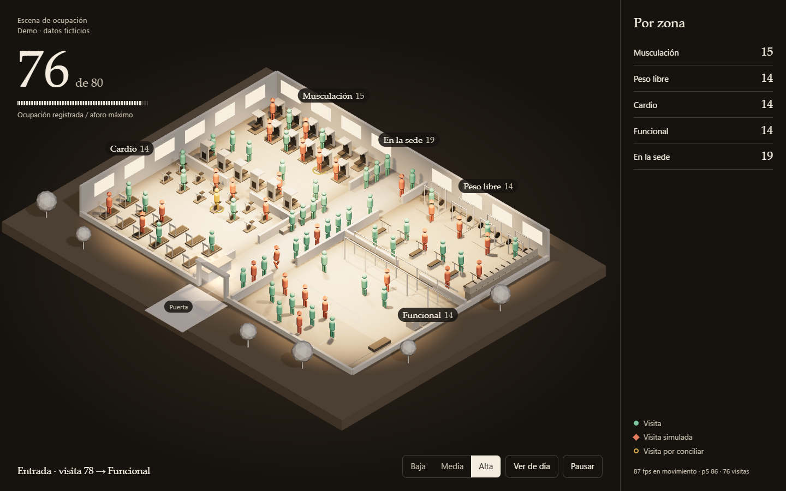
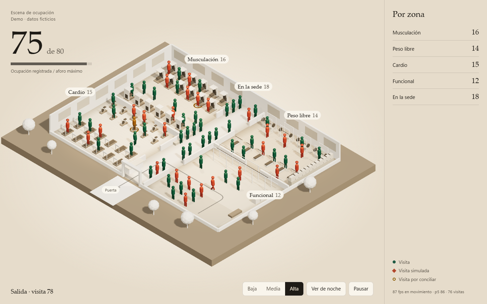
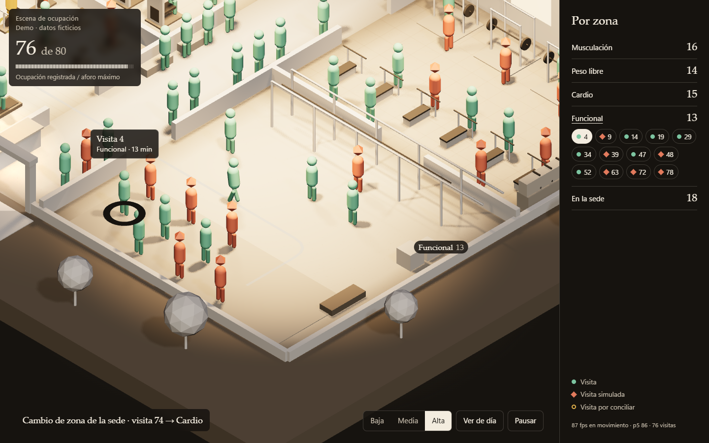
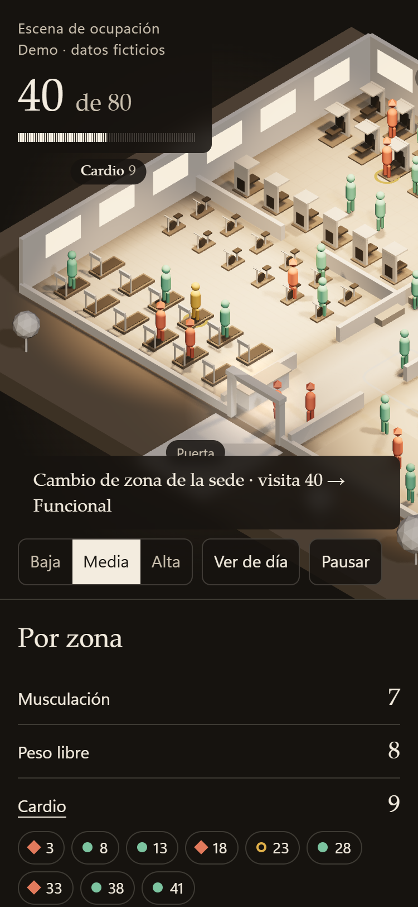

# Escena de ocupación: maqueta de papel

Dirección elegida para #153. Prototipo descartable, sin API. Reemplaza como referencia a las direcciones A y B de `prototipos/escena-ocupacion/`.

Desde la raíz del repositorio:

```powershell
python -m http.server 8000 --bind 127.0.0.1
```

Abrir <http://127.0.0.1:8000/prototipos/escena-ocupacion-maqueta/>.

## Principios

- **La sede es de papel, sin color; lo único con color son las personas.** Así la ocupación se lee de un vistazo.
- **Se distingue por forma además de color:** visita con cabeza redonda, visita simulada con cabeza en rombo, visita por conciliar con anillo en el piso.
- **El movimiento explica el cambio:** se camina por el carril central y las puertas, sin cruzar muros, y queda una estela neutra que se apaga.
- **La luz acompaña:** el foco de cada zona de la sede sube con su ocupación; la puerta brilla con cada entrada o salida.
- **Del conjunto al detalle:** elegir una zona acerca la cámara y lista sus visitas.
- **Sin trabajo por cuadro en reposo:** se dibuja solo mientras algo se mueve.

## Capturas

| Noche, ocupación alta | Día, ocupación alta |
|---|---|
|  |  |

| Zoom con tarjeta | Celular con zoom |
|---|---|
|  |  |

## Mediciones

Chrome sin interfaz en Windows 11, 30/10/2026, unas 76 visitas: 87 fps promedio y 86 p5, en escritorio 1280 × 800 y en celular emulado 375 × 812. Coinciden en ambos tamaños y parecen un tope del navegador, no el límite de la escena. **No representan un teléfono real**, y la escena usa cinco luces con sombra. En reposo dibuja 0 cuadros. Peso sin comprimir: 2,18 MB, casi todo Three.js.

Comprobado a mano con Playwright: selección con Enter, foco de la lista al redibujarse, movimiento reducido con cambios inmediatos, y sin WebGL queda solo «Por zona».
