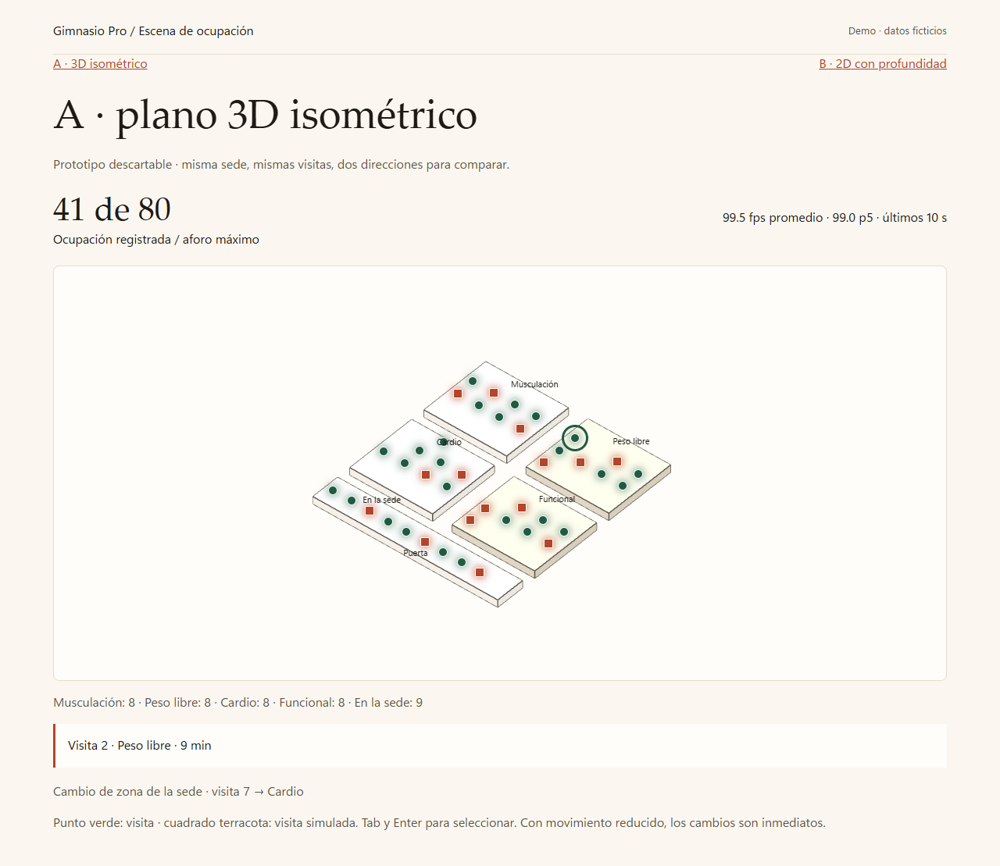
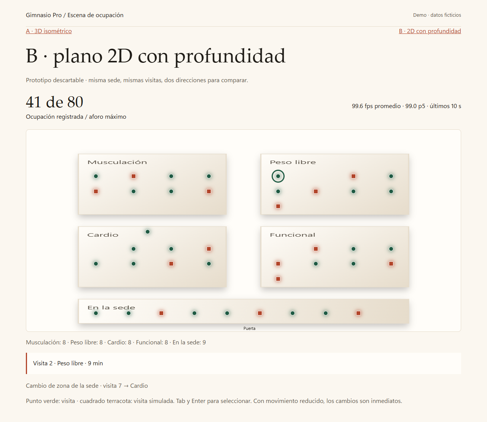
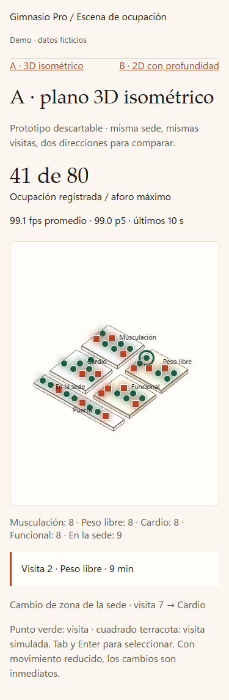
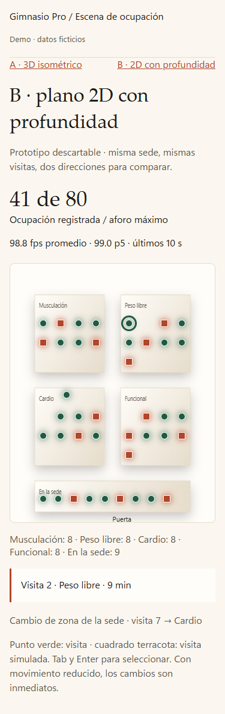

# Escena de ocupación: dos direcciones

Prototipos descartables de #152, parte de #141. Pregunta: ¿qué dirección muestra mejor la ocupación registrada y sus cambios, con impacto visual y movimiento cuidado? La elección queda para Opus; estas páginas no conectan con la API ni se integran en recepción.

Desde la raíz del repositorio:

```powershell
python -m http.server 8000 --bind 127.0.0.1
```

- [A · plano 3D isométrico](http://127.0.0.1:8000/prototipos/escena-ocupacion/a/): maqueta con Three.js r186 ya vendorizado.
- [B · plano 2D con profundidad](http://127.0.0.1:8000/prototipos/escena-ocupacion/b/): Canvas 2D, capas con sombras y gradientes de luz.

Ambas usan los tokens de la dirección B desde `gimnasio/static/estilos/tokens.css`, sin build ni recursos externos. `personas.json` contiene 40 visitas ficticias, aforo máximo 80 y las cuatro zonas de la sede más la franja «En la sede». La misma secuencia, en memoria, alterna entrada, cambio de zona de la sede y salida cada 2 s; la ocupación oscila entre 40 y 41. La entrada parte de la puerta y la salida vuelve a ella; cada recorrido dura 1,4 s.

Los puntos luminosos son botones superpuestos a las coordenadas del plano: círculos verdes para visitas y cuadrados terracota para visitas simuladas. Se seleccionan con ratón, toque o Tab y Enter/Espacio; el rótulo muestra identificador ficticio, zona de la sede, minutos y condición simulada. Con `prefers-reduced-motion: reduce` se conservan los cambios de estado, sin desplazamientos animados, incluso si la preferencia cambia con la página abierta.

## Capturas

Escritorio, 1280 × 1000 de ventana (captura de página completa):

| A · 3D isométrico | B · 2D con profundidad |
|---|---|
|  |  |

Celular emulado, **375 × 812**, escala 1 (captura de página completa):

| A · 3D isométrico | B · 2D con profundidad |
|---|---|
|  |  |

## Mediciones

| Dirección | Ventana | FPS promedio | FPS p5 | Peso descargado |
|---|---|---:|---:|---:|
| A · 3D | Escritorio 1280 × 1000 | 99,5 | 99,0 | 2.139.672 bytes |
| A · 3D | Celular 375 × 812 | 99,1 | 99,0 | 2.139.672 bytes |
| B · 2D | Escritorio 1280 × 1000 | 99,6 | 99,0 | 18.795 bytes |
| B · 2D | Celular 375 × 812 | 98,8 | 99,0 | 18.795 bytes |

Medido el 29/10/2026 en Windows 11, compilación 26200, procesador AMD64 Family 26 Model 68 Stepping 0 (AuthenticAMD), Chrome 156 sin interfaz mediante Playwright. Sin limitación de CPU ni red. El celular está emulado en esta misma PC: **no representa hardware de teléfono**. Son observaciones locales, no una garantía de rendimiento ni una elección de dirección.

El medidor usa intervalos de `requestAnimationFrame` de una ventana móvil de 10 s: promedio = cuadros / tiempo acumulado; p5 = percentil 5 de los fps instantáneos. Se descartan muestras al ocultar la pestaña. Las mediciones y capturas se toman después de 11 s, con movimiento activo y visitas entrando, cambiando de zona de la sede y saliendo. Los planos se dibujan al cargar o cambiar el tamaño; los puntos y su luz se mueven en la capa de botones en ambas direcciones. Se mide esta composición completa, no un renderizado 3D continuo.

Peso = suma de `encodedBodySize` del HTML y los recursos descargados en un contexto nuevo, sin compresión del servidor local; incluye CSS, JSON, JavaScript y, en A, los dos módulos de Three.js. Excluye capturas, este README y el script de verificación. Los valores completos y el navegador quedan en [mediciones.json](mediciones.json).

Para regenerar las cuatro capturas y las mediciones, desde la raíz:

```powershell
python prototipos/escena-ocupacion/verificar.py
# Alternativa con Chrome instalado:
python prototipos/escena-ocupacion/verificar.py --canal chrome
```

El script levanta su propio servidor local, comprueba las 40 visitas iniciales, selección por teclado y ratón, ausencia de desbordamiento a 375 px, y los tres cambios con movimiento reducido. Requiere Playwright de `requirements-dev.txt` y Chromium o Chrome instalado. En esta ejecución se usó Chrome: el Chromium de Playwright no estaba accesible y su descarga fue bloqueada por la red del entorno.
